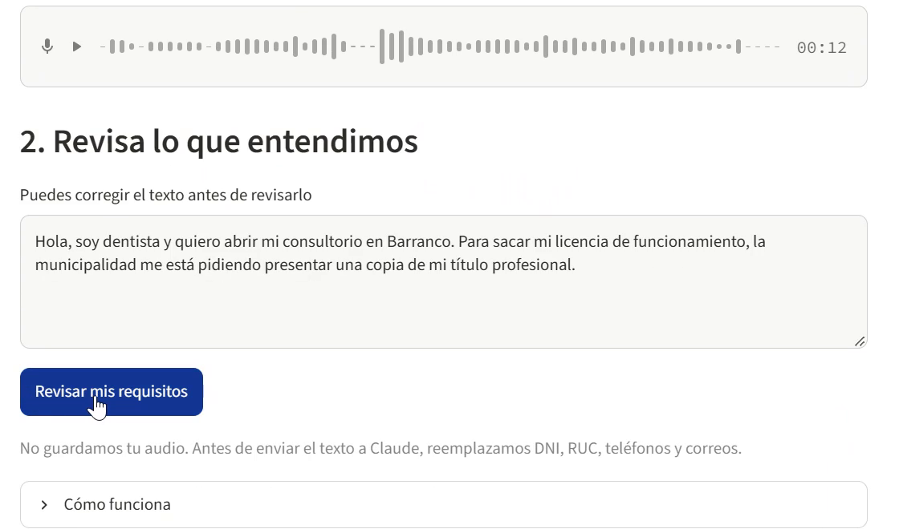
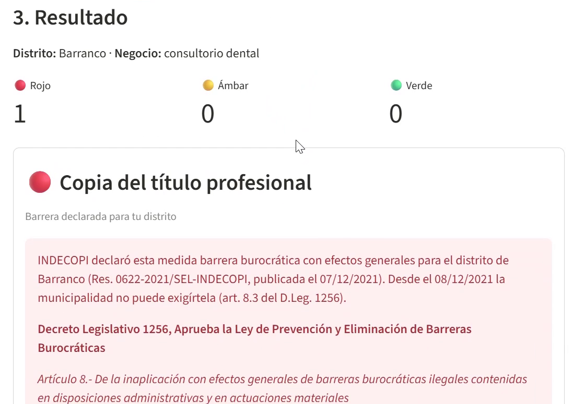
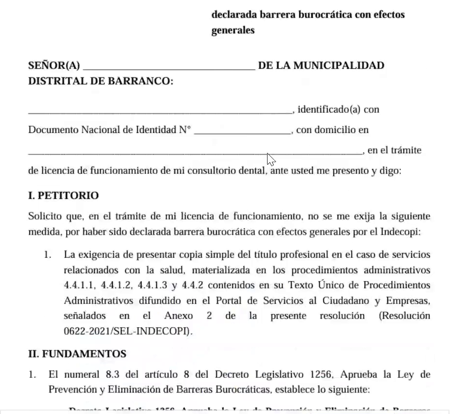
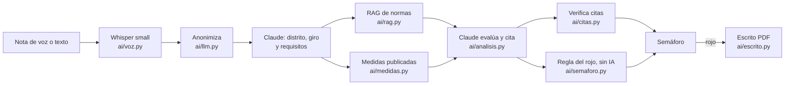

# TUPA bajo la lupa

**App:** https://tupa-bajo-la-lupa.streamlit.app/ · **Video de respaldo:** [docs/Demo-TUPA-bajo-la-lupa.mp4](docs/Demo-TUPA-bajo-la-lupa.mp4) · **Repo:** https://github.com/dgarcesg/proyecto-final

## 1. One-liner

Ayudamos a emprendedores de Lima a saber, con una nota de voz, si lo que les pide su municipalidad para la licencia de funcionamiento es legal y, si ya fue declarado barrera burocrática, les damos el escrito listo para presentarlo.

## 2. Founder


**Diana Adriana Garces Garcia**. Abogada especialista en Derecho de la Competencia y Regulación, con experiencia en eliminación de barreras burocráticas.

**Cómo cubro cada área con agentes de IA:**

| Área | Quién la hace |
|---|---|
| Producto y criterio legal | La founder: qué normas entran al corpus, qué medidas tienen efectos generales y para qué distrito, los textos fijos del rojo y del ámbar, y la redacción del escrito. |
| Ingeniería | Claude Code (Claude Opus 5.5), bajo la dirección de la founder: scraper, buscador, llamada a Claude, regla del semáforo, app, pruebas y despliegue. La founder revisa cada paso y decide los criterios legales (sección 9). |
| Diseño | Claude Code en Streamlit, con las indicaciones de la founder: cajas de color por requisito, denominación completa de las normas y citas con su numeral y literal. |
| Ventas | La founder, con foco en el pequeño emprendedor, que llega directo a la app. El gancho es la confianza: la herramienta la diseñó una abogada con experiencia en eliminación de barreras burocráticas. La consulta es gratis, y el emprendedor paga por el escrito solo cuando la ilegalidad es evidente (un rojo). Más adelante, la idea es recoger información de sectores específicos (como salud o bodegas) para especializar la herramienta, y que INDECOPI la adopte como herramienta propia. |

## 3. Problema

**Quién lo sufre:** los profesionales y pequeños emprendedores de Lima Metropolitana que abren o mantienen un local, como un consultorio de salud o una bodega, y hacen sin asesoría legal el trámite de su licencia de funcionamiento o la renovación de su ITSE.

**Cuánto les cuesta** (notas de 3 conversaciones en [`docs/research/`](docs/research/)):

- **Tiempo y logística.** A una odontóloga de Arequipa que busca local en Lima, algunas municipalidades le piden su título profesional original y otras, solo una declaración jurada; para empezar el trámite tendría que traer el título desde Arequipa ([conversación 1](docs/research/01_conversacion.md)). La ley solo exige la declaración jurada (literal d.1 del artículo 7 del TUO de la Ley 28976).
- **Tramitadores y pagos indebidos.** Una médica con consultorio en Pueblo Libre paga tramitadores cada vez que renueva su ITSE, porque no conoce la materia, y contó que a veces le han pedido coima ([conversación 2](docs/research/02_conversacion.md)).
- **Cobros que ya no se pueden exigir.** Por ejemplo, INDECOPI declaró barrera burocrática con efectos generales un cobro de S/ 148.60 de Santa Anita por la licencia de riesgo bajo.

**Cómo lo resuelven hoy:** cumplen lo que les pide la municipalidad, pagan a un tramitador o consultan a un abogado. Pero ni un abogado especialista en barreras burocráticas tiene una herramienta centralizada: unir una resolución del portal de INDECOPI con su publicación en El Peruano, que es la que hace que opere la inaplicación, ya es difícil para él, y no se imagina cuánto más lo es para un emprendedor ([conversación 3](docs/research/03_conversacion.md)).

**Lo que muestran los datos públicos** (al 10/11/2026, ver [Fuentes de datos](#fuentes-de-datos)):

- INDECOPI declaró barreras burocráticas, **con efectos generales**, **396 medidas de municipalidades de Lima Metropolitana, en 38 distritos**. Desde el día siguiente de su publicación en El Peruano, la municipalidad que impuso cada una ya no puede exigírsela a nadie (art. 8.3 del D.Leg. 1256).
- Esa información está repartida entre el buscador de El Peruano y un Excel de INDECOPI, escrita en lenguaje legal. No hay una forma simple de buscar "¿me pueden pedir esto en mi distrito?".

## 4. Solución e insight

**Qué construimos.** Una app web en la que el emprendedor cuenta, en una nota de voz o por escrito, su distrito, su negocio y lo que le pide la municipalidad. La app le responde, requisito por requisito:

- 🔴 **Rojo:** INDECOPI declaró esa medida barrera burocrática con efectos generales para su distrito, y ya surte efecto. La app le da un **escrito en PDF** para presentarlo en mesa de partes.
- 🟡 **Ámbar:** hay resoluciones de INDECOPI sobre otros distritos, o normas que podrían sustentar su ilegalidad. Se muestran con su base legal.
- 🟢 **Verde:** la norma permite pedirlo.

Cada respuesta cita la norma con su denominación completa y el texto exacto del artículo, y el sistema comprueba que la cita esté palabra por palabra en la ley.

**Insight.** La inaplicación con efectos generales ya protege a todos los emprendedores del distrito, pero la información está dispersa y en lenguaje legal, así que el emprendedor difícilmente sabe que su caso ya fue resuelto. No hace falta litigar ni que una IA "opine" sobre la legalidad: basta cruzar lo que le piden con las resoluciones ya publicadas. Por eso la IA solo traduce y busca, y **el rojo lo decide una regla fija**, no el modelo.

## 5. Why now

- **La voz ya se puede transcribir gratis y sin sacar el audio del servidor.** Whisper es un modelo abierto que corre en el procesador de un servidor gratuito. Transcribir no cuesta nada por consulta y el audio no se comparte con terceros.
- **Los LLM ya devuelven respuestas estructuradas y citables a bajo costo.** Claude entrega cada requisito en un formato fijo, con la norma y la frase citada, y el código puede verificar esa frase. Una consulta completa cuesta unos US$ 0.12.
- **Los datos ya son públicos y descargables.** INDECOPI publica el listado de resoluciones con efectos generales (actualizado al 06/11/2026), El Peruano tiene un buscador consultable y el SPIJ exporta las normas.
- **Está en la agenda.** La lista actual de Requests for Startups de Y Combinator (invierno 2027) incluye *AI for City Hall*: IA para permisos, licencias y trámites municipales.

## 6. Demo

**URL pública:** https://tupa-bajo-la-lupa.streamlit.app/. La primera visita tarda 1–2 minutos mientras carga los modelos.

1. **Cuéntanos tu caso:** graba una nota de voz, sube un audio o escribe. También hay un botón con un audio de ejemplo (voz sintética, caso inventado: una bodega en San Juan de Lurigancho).
2. **Revisa lo que entendimos:** el texto transcrito se puede corregir antes de enviarlo.
3. **Resultado:** un semáforo por requisito, con la resolución de INDECOPI y la base legal en cajas de color. Si hay rojo, aparece el botón para descargar el escrito en PDF.

**Capturas del flujo principal** (la consulta del video: consultorio dental en Barranco):

1. **El caso:** la nota de voz, transcrita por Whisper, que la persona puede corregir antes de revisarla.

   

2. **El semáforo:** rojo, con la resolución de INDECOPI y el art. 8 del Decreto Legislativo 1256.

   

3. **El escrito en PDF:** listo para mesa de partes, con los datos de la persona en blanco.

   

**Video de respaldo:** [docs/Demo-TUPA-bajo-la-lupa.mp4](docs/Demo-TUPA-bajo-la-lupa.mp4): consultorio dental en Barranco, de la nota de voz al escrito en PDF.

### Arquitectura

Detalle en [`docs/arquitectura.md`](docs/arquitectura.md).



### Modelos y servicios, y por qué

| Pieza | Qué usamos | Dónde corre | Por qué |
|---|---|---|---|
| Voz a texto | faster-whisper `small`, cuantizado a int8 ([`ai/voz.py`](ai/voz.py)) | En el servidor de la app, sin GPU | El audio no sale a otro servicio y no se guarda. El tamaño `small` equilibra calidad en español y memoria: junto con lo demás, entra en el servidor gratuito (la app completa usa unos 1,7 GB). Puede equivocarse con nombres de distritos, por eso la persona revisa el texto y Claude normaliza el distrito. |
| Búsqueda de normas | `intfloat/multilingual-e5-small` + ChromaDB ([`ai/rag.py`](ai/rag.py)) | En el servidor | Embeddings multilingües que funcionan en CPU. Cubren 468 fragmentos de 5 normas, y el índice va precalculado en el repo. |
| Medidas parecidas | El mismo modelo e5-small ([`ai/medidas.py`](ai/medidas.py)) | En el servidor | Por cada requisito elige 5 medidas del distrito y 3 de otras municipalidades, de las 530 publicadas, para que Claude no reciba las 530. |
| Comprensión y evaluación | Claude Opus 5.5 (`claude-opus-5-5`) con salidas estructuradas y Pydantic ([`ai/llm.py`](ai/llm.py), [`ai/prompts.py`](ai/prompts.py)) | API de Anthropic | Entiende cómo habla el emprendedor y devuelve un esquema validado. Usa esfuerzo bajo para extraer y medio para evaluar. El texto se anonimiza antes de enviarse. |
| Semáforo rojo | Regla en Python, sin IA ([`ai/semaforo.py`](ai/semaforo.py), [`ai/textos.py`](ai/textos.py)) | En el servidor | Una decisión legal no se deja a un modelo. Rojo solo con una resolución publicada, con efectos generales para ese distrito, vigente y que ya surte efecto. |
| Escrito | fpdf2 ([`ai/escrito.py`](ai/escrito.py)) | En el servidor | Plantilla fija redactada por la founder, sin datos personales: se llenan a mano. |
| Hosting | Streamlit Community Cloud | — | Es gratis. Hugging Face Spaces pasó a exigir suscripción PRO para apps Docker; el [`Dockerfile`](Dockerfile) queda en el repo por si se migra. |

### Cómo correrlo en local

```bash
conda create -n tupa python=3.12 -y
conda activate tupa
pip install -r requirements.txt
cp .env.example .env        # y pega tu ANTHROPIC_API_KEY en .env
streamlit run app/app.py
```

Pruebas (no usan la API de Claude):

```bash
python -m tests.test_semaforo   # regla del semáforo rojo
python -m tests.test_normas     # división de las normas por artículo
python -m tests.test_voz        # transcripción (carga Whisper; ~20 s)
python -m tests.test_analisis   # flujo completo con Claude simulado (no gasta crédito)
python -m tests.test_app        # la app de Streamlit con el audio de ejemplo y Claude simulado (~1-2 min)
python -m tests.test_citas      # cómo se arma cada cita de la base legal (nombre completo, numeral y literal)
python -m tests.test_escrito    # el escrito en PDF para el rojo (resolución, art. 8.3 y 34.1 del D.Leg. 1256)
python -m ai.rag buscar "me piden croquis de ubicación"   # prueba del buscador
```

## 7. Modelo de negocio

**Quién paga y cuánto:** sobre todo el pequeño emprendedor, y solo cuando la ilegalidad es evidente: cuando la app encuentra un rojo, paga por el escrito. Como opción, los gremios pueden pagar por sus asociados.

| Plan | Para quién | Precio (con IGV) | Qué incluye |
|---|---|---|---|
| **Gratis** | El emprendedor que está sacando su licencia | S/ 0 | Hasta 3 consultas al mes: semáforo por requisito y base legal |
| **Escrito** | El emprendedor con un requisito en rojo | **S/ 19.90 por escrito**, pago único con Yape o Plin | El escrito en PDF para presentarlo en mesa de partes |
| **Gremio** | Asociaciones de bodegueros, cámaras de comercio, colegios profesionales | **S/ 290 al mes** | Hasta 200 consultas al mes para sus asociados, escritos incluidos, y un reporte mensual de las barreras declaradas en sus distritos |

¿Por qué S/ 19.90? Es mucho menos de lo que el escrito puede ahorrarle: en Santa Anita, por ejemplo, INDECOPI declaró barrera burocrática un cobro de S/ 148.60 por la licencia de riesgo bajo.

**Más adelante:** que INDECOPI adopte la herramienta como propia, para que cualquier emprendedor sepa si lo que le piden ya fue declarado barrera. Todavía no es un plan con precio.

**Cuánto cuesta cada consulta** (medido el 10/11/2026 con el audio de ejemplo):

| Concepto | Costo por consulta |
|---|---|
| Claude Opus 5.5: 2 llamadas, unos 20 mil tokens de entrada (US$ 4 por millón) y la salida (US$ 20 por millón) | unos **US$ 0.11–0.12** |
| Whisper y buscador | US$ 0: corren en el servidor de la app |
| Servidor (Streamlit Community Cloud) | US$ 0 en el plan gratuito |
| **Total variable** | **unos US$ 0.12 por consulta** (unos S/ 0.42, con un tipo de cambio referencial de S/ 3.50) |

**Margen de contribución por plan** (sobre el precio sin IGV; la comisión de Yape o Plin para comercios se estima en 4 %):

| Plan | Ingreso sin IGV | Costo variable | Margen |
|---|---|---|---|
| Gratis | S/ 0 | Hasta 3 consultas: S/ 1.26 al mes | −S/ 1.26: es el costo de conseguir al usuario |
| Escrito | S/ 16.86 | 1 consulta (S/ 0.42) + comisión (S/ 0.80) = S/ 1.22 | **S/ 15.64 (93 %)** |
| Gremio | S/ 245.76 | 200 consultas: S/ 84.00 | **S/ 161.76 (66 %)** |

**Costo fijo:** hoy, US$ 0 (Streamlit Community Cloud). Con usuarios reales, un servidor con 4 GB de memoria (la app usa unos 1.7 GB), de unos US$ 20–40 al mes. Se cubre con unos 9 escritos al mes, o con un solo gremio.

Para cuidar el crédito, la app permite 5 consultas por visitante y 60 al día en total, y la cuenta de Anthropic tiene un tope de gasto.

## 8. Herramientas del curso

| Herramienta | Sesión | Dónde está en el repo | Por qué esta |
|---|---|---|---|
| Scraping y APIs | 03 | [`scraper/elperuano.py`](scraper/elperuano.py): busca "barrera burocrática" en El Peruano y lee los campos de cada resolución. [`scraper/listado_indecopi.py`](scraper/listado_indecopi.py): agrega el Excel de INDECOPI. [`scraper/excel_revision.py`](scraper/excel_revision.py), [`scraper/fuera_de_lima.py`](scraper/fuera_de_lima.py) y [`scraper/cargar_revision.py`](scraper/cargar_revision.py): revisión de la founder y tabla final | Las resoluciones con efectos generales solo están publicadas en El Peruano y en un Excel. Sin scraping no hay semáforo rojo. |
| LLM con salidas estructuradas y RAG | 08 | [`ai/normas.py`](ai/normas.py), [`ai/rag.py`](ai/rag.py) (embeddings e5 + ChromaDB), [`ai/medidas.py`](ai/medidas.py), [`ai/llm.py`](ai/llm.py), [`ai/prompts.py`](ai/prompts.py), [`ai/schemas.py`](ai/schemas.py), [`ai/analisis.py`](ai/analisis.py), [`ai/citas.py`](ai/citas.py) | El emprendedor habla en lenguaje común y la norma está en lenguaje legal. El RAG trae los artículos correctos, y la salida estructurada permite verificar cada cita y aplicar la regla del rojo en código. |
| Voz a texto con Whisper | 13 | [`ai/voz.py`](ai/voz.py), [`app/app.py`](app/app.py) (grabar o subir audio) | Contar el caso en una nota de voz es más fácil que llenar un formulario legal. El audio se transcribe en el servidor y no se guarda. |
| Despliegue de productos de datos | 12 | [`requirements.txt`](requirements.txt) (torch solo para CPU), [`.streamlit/config.toml`](.streamlit/config.toml), [`Dockerfile`](Dockerfile), [`tests/`](tests/) | URL pública gratuita, con pruebas que no gastan crédito. |

## 9. Qué hizo el agente

Claude Code (Claude Opus 5.5) escribió el código del repo, en sesiones con la founder entre el 9 y el 10 de noviembre de 2026. La founder tomó las decisiones legales y revisó cada paso.

| Parte | Qué hizo Claude Code | Qué decidió la founder |
|---|---|---|
| Estructura | Carpetas, `.gitignore`, `.env.example`, `requirements.txt` y el esqueleto del README, a partir de un brief de diseño de la founder | El problema, el alcance (Lima Metropolitana, licencia de funcionamiento) y las reglas de privacidad |
| Datos ([`scraper/`](scraper/)) | Scraper de El Peruano, carga del listado de INDECOPI, Excel de revisión con listas desplegables, marca de municipalidades fuera de Lima y carga final validada | Revisó las 530 medidas: efectos generales, distrito, qué se usa en la app y cuáles fuera de Lima quedan solo como referencia ([`data/publicaciones/LEEME.md`](data/publicaciones/LEEME.md)) |
| Normas y RAG ([`ai/normas.py`](ai/normas.py), [`ai/rag.py`](ai/rag.py)) | Lectura de las normas del SPIJ por artículo, quedándose con el texto vigente; embeddings y ChromaDB | Eligió las 5 normas. Comparó el TUO de la Ley Marco con una descarga directa del SPIJ y decidió mantener los textos modificatorios. |
| Voz ([`ai/voz.py`](ai/voz.py)) | Whisper en el servidor, sin guardar el audio, y un audio de ejemplo con voz sintética y un caso inventado | Que no se guarden audios |
| Claude ([`ai/llm.py`](ai/llm.py), [`ai/prompts.py`](ai/prompts.py), [`ai/analisis.py`](ai/analisis.py)) | La única llamada a la API, con anonimización; los prompts; la verificación de que cada cita esté palabra por palabra en la norma | Los criterios para relacionar un requisito con una medida publicada y qué giros cuentan como bodega |
| Semáforo ([`ai/semaforo.py`](ai/semaforo.py), [`ai/textos.py`](ai/textos.py)) | La regla del rojo en código y las pruebas | La regla de colores y los textos fijos del rojo y de los precedentes en ámbar |
| Citas ([`ai/citas.py`](ai/citas.py)) | Nombre completo de cada norma, encabezado del artículo y el numeral y literal citados, con "(...)" donde se saltan párrafos | El formato de cita y que el art. 7 de la Ley Marco vaya siempre completo |
| App ([`app/app.py`](app/app.py)) | Interfaz en Streamlit, límites de consultas y mensajes de error | La presentación de la base legal en cajas de color, sin desplegables |
| Escrito ([`ai/escrito.py`](ai/escrito.py)) | El PDF con fpdf2 y sus pruebas | La redacción: destinatario en blanco, fundamento en la inaplicación con efectos generales y numeral 34.1 del D.Leg. 1256, sin otras normas |
| Despliegue | `requirements.txt` para el servidor, `Dockerfile`, intento en Hugging Face (exigía PRO) y publicación en Streamlit Community Cloud | Usar el plan gratuito de Streamlit y poner un tope de gasto en Anthropic |
| Seguridad | Revisión del historial con `git log -p`: ninguna clave en el repo y `.env` nunca subido | Puso ella misma las claves en `.env` y en los secretos del servidor, sin pegarlas en el chat |

## Fuentes de datos

| Fuente | Rango | Para qué |
|---|---|---|
| Normas en `data/normas/` (exportadas del SPIJ): D.Leg. 1256 (con la Ley 32587), TUO de la Ley 27444 (DS 006-2026-JUS), TUO de la Ley Marco de Licencia de Funcionamiento (DS 163-2020-PCM), D.Leg. 1246, Ley 31866 | Vigentes al 10/11/2026 | Corpus del RAG: 468 fragmentos |
| Scraper de El Peruano (INDECOPI, municipalidades) | 01/01/2025 – 10/11/2026 | Semáforo rojo |
| [Listado de INDECOPI de resoluciones con efectos generales](https://www.gob.pe/institucion/indecopi/informes-publicaciones/4292797-listado-de-resoluciones-con-efectos-generales_barreras-burocraticas) | 2017 – 06/11/2026 | Semáforo rojo (complementa al scraper) |

En total hay **530 medidas de 222 resoluciones**. De ellas, 396 son de municipalidades de Lima Metropolitana; las de fuera de Lima solo sirven como precedente. Las dos fuentes de publicaciones tienen **rangos de fechas distintos**; el detalle de cómo se combinan está en [`data/publicaciones/LEEME.md`](data/publicaciones/LEEME.md). Todo es información pública; no hay datos personales.

## Privacidad y seguridad

- El audio se transcribe en el servidor y **no se guarda**.
- Antes de enviar el texto a Claude, se reemplazan **DNI, RUC, teléfonos y correos**.
- El escrito no pide datos personales: el nombre, el DNI y el domicilio se llenan a mano.
- Las claves están en `.env` (local) y en los secretos del servidor, **nunca en el repo**. Hay tope de gasto y límite de consultas.

## Estructura del repo

```
app/                 # interfaz en Streamlit
ai/                  # prompts, esquemas Pydantic, RAG, citas, semáforo, escrito y la única llamada a Claude (ai/llm.py)
scraper/             # El Peruano, listado de INDECOPI y revisión de la founder
data/normas/         # textos legales (exportados del SPIJ) y su índice de búsqueda (indice/)
data/publicaciones/  # inaplicaciones con efectos generales publicadas en El Peruano
data/demo/           # audio de ejemplo (voz sintética, caso inventado)
deploy/              # publicación en Hugging Face Spaces (requiere PRO; no se usa)
docs/                # arquitectura y capturas
docs/research/       # notas de las 3 conversaciones con usuarios
tests/               # pruebas: semáforo, normas, voz, citas, escrito, flujo y app
notebooks/           # exploración
```

## Aviso

TUPA bajo la lupa da **orientación, no asesoría legal**. Los casos complejos deben verse con un abogado.

## Licencia

[MIT](LICENSE)
