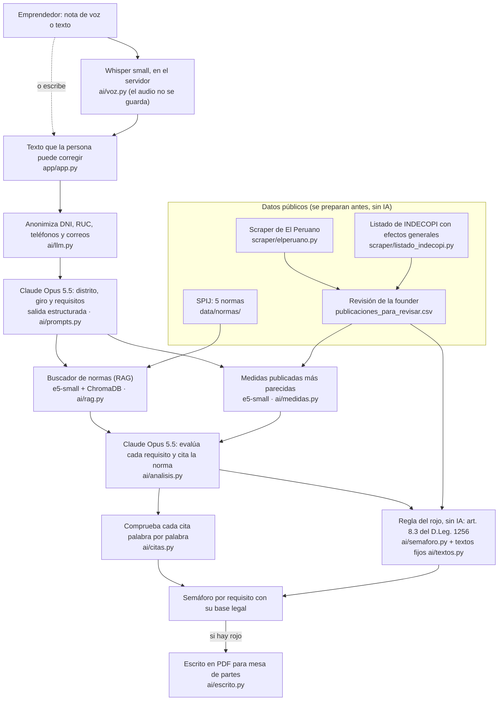

# Arquitectura de TUPA bajo la lupa

## Cómo leerlo

1. **Voz a texto.** Whisper (`small`, int8) corre en el mismo servidor de la app: el audio no se envía a otro servicio y no se guarda. La persona ve el texto y puede corregirlo.
2. **Extracción.** Antes de enviar el texto a Claude, el código reemplaza DNI, RUC, teléfonos y correos. Claude devuelve, en un esquema fijo (Pydantic), el distrito, el giro y la lista de requisitos.
3. **Búsqueda.** Para cada requisito, el buscador trae los artículos más parecidos de las 5 normas (468 fragmentos) y las medidas publicadas más parecidas: 5 del distrito de la persona y 3 de otras municipalidades.
4. **Evaluación.** Claude evalúa cada requisito, solo como ámbar o verde, citando la norma y copiando la frase exacta. El código comprueba que esa frase esté palabra por palabra en el artículo citado; si no está, la cita no se muestra.
5. **Rojo.** El rojo no lo decide la IA. Sale solo si el requisito coincide con una medida de **ese distrito** que INDECOPI declaró barrera burocrática **con efectos generales**, publicada en El Peruano y vigente, y desde el día siguiente de su publicación (art. 8.3 del D.Leg. 1256). Los textos del rojo y de los precedentes son fijos, redactados por la founder.
6. **Escrito.** Si hay algún rojo, la app arma un escrito en PDF con la resolución, el art. 8.3 y el numeral 34.1 del D.Leg. 1256 (multa al funcionario que incumple el mandato de inaplicación). La persona llena a mano su nombre, DNI y domicilio.
